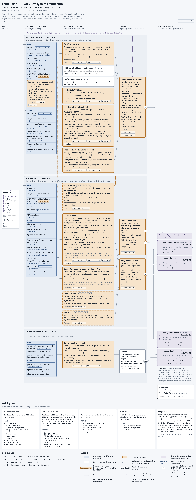

# FourFusion — FLAG 2027 (Evaluation 13.54)

Code of team **FourFusion** for the FLAG 2027 Grand Challenge (ICASSP 2027): decide whether a face image and a voice clip belong to
the same person (MAV-Celeb v4). This repository rebuilds the displayed Evaluation submission.

| target | value |
|---|---|
| displayed submission | CodaBench submission **1054704** (user `minhnhien2811`) |
| file | `xjf_r10_trsig.zip`, sha256 `b4354eaf988b2b4ea8c4e1c3fa44d7bcf631ea5cb3cd635ab2965021fe82e507` |
| Evaluation EER | **13.54** = 10.20 (no_gender/English) · 11.97 (no_gender/Bangla) · 12.98 (gender/English) · 18.99 (gender/Bangla) |

**Team FourFusion**, University of Information Technology, VNU-HCM: Nguyen Chon Nhan, Dang Minh Nhien, Vu Nguyen Anh Dung, Nguyen
Huu Bao Loc; advisor Nguyen Duy Tam Anh.

**Data and checkpoints** are in the Google Drive folder `FourFusion_FLAG2027_data/`, shared with the organisers only, because it
holds their data and VoxBlink-derived material (layout: [`DATA.md`](DATA.md), [`CHECKPOINTS.md`](CHECKPOINTS.md)).

## 1. The system



Full-size diagram: [PDF](docs/figures/system_diagram.pdf) · [HTML](docs/figures/system_diagram.html).

Every trial is scored on its own, from its face and its voice. Two model families score every trial; a third branch also scores the
English trials; a fixed rule per test file combines them. All constants come from training or external data, never from the test
files.

- **Identity-classification family** (internal name F1s′). Frozen face encoders (VGG-Face, ImageBind, ViT age, FaRL, CLIP ViT-L/14
  with an identity low-rank adapter C5s) and frozen voice encoders (ECAPA-TDNN, ImageBind audio, audEERING age–gender, SimAM-ResNet100,
  WeSpeaker ResNet293 / ECAPA-1024). Seven component scores (bridge heads, ImageBind cosine, age match, InfoNCE head, shared-prototype
  head) and trial conditions enter a conditional logistic fuser fitted on held-out training identities → logit ℓ_F.
- **Pair-contrastive family** (internal name RFX). A linear projector maps concatenated face and voice embeddings into one space
  (symmetric InfoNCE, 3 seeds), plus side streams (ImageBind cosine with the audio adapter C1, gender probes, age match); one fuser for the
  gender files and one for the no-gender files → logit ℓ_R. For the gender/Bangla file the variant RFX′ adds the trained voice block B2 → ℓ_R′.
- **DP (Different Profile) branch**, English files only. Two towers on frozen recognition embeddings (face: VGG-Face, AdaFace, ArcFace;
  voice: two ECAPA-TDNN) trained with a symmetric InfoNCE loss, 10 seeds averaged → cosine c_DP, standardised with μ_DP / σ_DP
  measured on held-out training trials.
- **Per-file rule** (chosen by the file's language and protocol, given by the organisers). Each file stores −s (lower = same person):

| file | score s |
|---|---|
| no_gender / Bangla | ℓ_F + ℓ_R |
| gender / Bangla | ℓ_F + ℓ_R′ |
| no_gender / English | (ℓ_F + ℓ_R) / 5.098 + (c_DP − μ_DP) / σ_DP |
| gender / English | (ℓ_F + ℓ_R) / 3.838 + (c_DP − μ_DP) / σ_DP |

5.098 and 3.838 are the standard deviations of ℓ_F + ℓ_R on held-out training English trials of each protocol; on English trials
ℓ_F uses the fuser fitted for Bangla. Training data: the organisers'
v4 training set, MAV-Celeb v1 / v2, VoxCeleb2 and VoxBlink; every voice source is filtered for Bengali speech by speaker. Internal
names and their public names: [`docs/NAMING.md`](docs/NAMING.md). The LoRA C1 of 13.54 is the original version (it learned 210
MAV-Celeb v1 clips of 70 persons); the runner refuses close variants ([`docs/VARIANTS.md`](docs/VARIANTS.md)).

## 2. Repository layout

```
runner/        ffrun.py (command line), ffcore.py (engine), check_stage.py, verify.py, build_kaggle_notebook.py, selftest.py
configs/       data_map.json (artifact id -> FF_DATA path), modes.json, variant_1354.json, pipeline_1354.json, expected_sha256.json
stages/        91 stages in 11 groups (10_raw ... 80_final) + 2 environment stages in tools/stages/00_env; each: stage.json,
               stage.ipy (cells of the run), CHANGES.md, original/
assembly/      byte-exact assembly of the zip from the stored per-pair scores: assemble_exact.py + expected.json
notebooks/     Kaggle orchestration notebooks FourFusion_1354_{infer,train,assemble}.ipynb (generated)
docker/        environment specification (Kaggle base image digests, pinned pip sets, reference Dockerfile; Docker is optional)
tools/         fetch_models.py (pinned pretrained models), dp_train_local.py, drive_manifest.py, secret_scan.py, build_docs.py
src/           read-only copies of the team's builders and modules (SRC_MANIFEST.json); not needed to run
docs/          STAGES.md, VERIFICATION.md, COMPLIANCE_NOTES.md, VARIANTS.md, NAMING.md, CHANGES_FROM_ORIGINAL.md, figures/
```

Every stage keeps the **code that actually ran** (the executed Kaggle notebook or the local script), copied verbatim. Each change is
listed with its reason in the stage's `CHANGES.md` (all merged in [`docs/CHANGES_FROM_ORIGINAL.md`](docs/CHANGES_FROM_ORIGINAL.md));
the run-time rewrites of the runner (`/kaggle/input` → the stage's own input view, upload switched off, …) are in
`runner/RUNTIME_CHANGES.md`. The stage list with devices and run times is [`docs/STAGES.md`](docs/STAGES.md).

## 3. Running

All modes use one data root, `FF_DATA`, with the layout of the Drive folder ([`DATA.md`](DATA.md)), and one work folder, `FF_WORK`.
The runner needs only Python 3 (the team used 3.13 / 3.14); the stages need the Kaggle image environment
([`docker/README.md`](docker/README.md); `FF_PIP=pinned` applies the pinned package set). `python runner/ffrun.py plan --mode <mode>`
shows what would run and where every input comes from, without data.

### (c) Byte-exact zip from the stored per-pair scores — CPU, under a minute

```bash
python assembly/assemble_exact.py --inputs <FF_DATA>/05_scores --out <out>
# or through the runner (stages a_factor, a_fvbind, dp_sigma, final_blend, final_verify)
FF_DATA=<FF_DATA> FF_WORK=<work> python runner/ffrun.py run --mode assemble
python runner/verify.py zip <work>/art/notebooks/ff/final_blend/zips/xjf_r10_trsig.zip --expected xjf_r10_trsig
```

The four member files come out byte-identical to the submission (sha256 in `assembly/expected.json`).

### (b) Inference from the Evaluation media and the released checkpoints — about 12 GPU-hours (T4) + 1 CPU-hour

```bash
FF_DATA=<FF_DATA> FF_WORK=<work> python runner/ffrun.py plan --mode infer
FF_DATA=<FF_DATA> FF_WORK=<work> python runner/ffrun.py run  --mode infer          # 19 stages
```

Starts from `evaluation_phase.zip` (stage `raw_evalphase`), extracts features of the four Evaluation lists, scores them with the
saved checkpoints of the identity-classification family, RFX / RFX′ and DP, and assembles the zip. GPU arithmetic is not
bit-identical, so compare per file with Spearman's correlation (`runner/verify.py`).

### (a) Rebuild from the raw and collected data — about 150–170 GPU-hours (T4) + 10 CPU-hours

```bash
FF_DATA=<FF_DATA> FF_WORK=<work> python runner/ffrun.py run --mode train --only <stage,...>     # one session per call
# every stage of the 13.54 lineage from its producer (configs/modes.json -> modes.train.full_rebuild_from_raw)
FF_USE_SAVED=none FF_FORCE=raw_mavceleb,safe04_lab,f14_av,gather_g1,t163l_orig,f32_aclip_full,b_lab_avfull \
    FF_DATA=<FF_DATA> FF_WORK=<work> python runner/ffrun.py run --mode train --only <stage,...>
# add the collect stages to FF_FORCE to re-collect VoxCeleb2 / VoxBlink from Hugging Face (needs HF_TOKEN)
python runner/ffrun.py run --mode train --only l_groups      # rebuilds the four VoxCeleb2 lists the F stages embed, byte check
python runner/ffrun.py dag                                   # section LINEAGE: every input of every 13.54 stage traced to raw data
```

GPU training is not deterministic, so this is a recipe-level rebuild. With the command above, every input of every stage that the
13.54 zip depends on comes from its producing stage, starting from raw / collected data, public pretrained models and configuration
files (`ffrun.py dag`, section LINEAGE: 0 gaps). Wiring inputs marked `"optional": true` in `stage.json` (v6 members of `e50cc`,
the dev wiring of `safe04_lab`, the e2e-dev bundle of `t164f`) are simply absent: the stage does without them and no 13.54 number
depends on them. The original LoRA C1 defines the 13.54 variant: modes (b) and (c) take its saved copy; here `t163l_orig` retrains it
with the original code (key bug kept, `docs/VARIANTS.md`), checked by the lineage guard. The DP branch trains on CPU:
`python tools/dp_train_local.py --help`.

### On Kaggle

Use `notebooks/FourFusion_1354_{assemble,infer,train}.ipynb` (built by `runner/build_kaggle_notebook.py`): attach the code bundle
and the data in the Drive layout, and set `FF_ONLY` per session (a Kaggle session lasts at most 12 hours). Stages whose code reads the
literal `/kaggle/input` run in a session with exactly their inputs attached (`runner/README.md`).

## 4. Hardware

GPU stages ran on Kaggle with NVIDIA Tesla T4 (one or two per run); small steps ran on Kaggle CPU sessions or on the team's CPU
machine. Per-stage minutes are in [`docs/STAGES.md`](docs/STAGES.md).

## 5. Checks

[`docs/VERIFICATION.md`](docs/VERIFICATION.md): every stage rebuilds from its original notebook or script, the stage graph is
consistent, mode (c) reproduces the four submitted files byte for byte, and the DP branch retrained on CPU gives bit-identical scores.

## 6. Compliance

No organisers' dev data is used for training, fitting or selection; no score normalisation, cohort, CSLS or test-time adaptation;
Bengali voices are removed from every voice source by speaker; pretrained encoders are frozen and declared ([`LICENSES.md`](LICENSES.md));
VoxBlink material and the organisers' data are not in this repository. The English gain of 13.54 comes from the DP branch, which
trains on MAV-Celeb v1 / v2; the team's own studies suggest that the gain comes from recordings shared between the English Evaluation
file and MAV-Celeb v1 / v2. Details and the submission history: [`docs/COMPLIANCE_NOTES.md`](docs/COMPLIANCE_NOTES.md).
